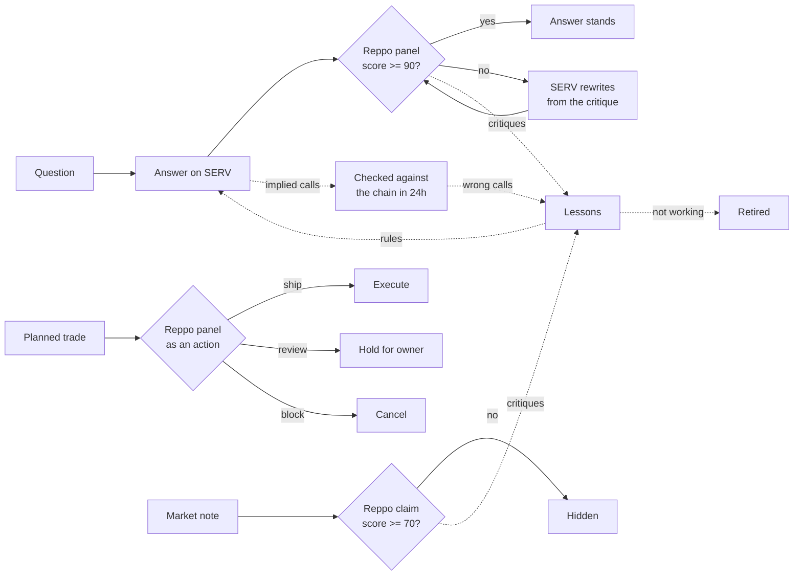

# convik-reppo-quality

**An agent that gets graded twice: by its peers, and by the market.**

This is the quality layer behind [Convik Terminal](https://app.convik.xyz/terminal), an agentic terminal for tokenized stocks on Robinhood Chain. Every answer the agent writes, every trade it wants to make and every note it publishes is scored by [Reppo](https://eval.reppo.xyz)'s independent evaluator panel before it counts. Six learning loops turn that feedback, and the market's own verdict a day later, into an agent that measurably improves.

Reasoning runs on [SERV Reasoning](https://docs.openserv.ai). Built for the SERV Hackathon, Edition 02 (Reppo track).

[](https://github.com/topguyaii/convik-reppo-quality/actions/workflows/ci.yml)

## Why

An agent that checks its own work isn't credible, least of all one that moves money. Grounding checks catch invented numbers, but not a misleading answer, a weak argument or a trade that drifts from what the owner asked for. So the judge is never the agent: it's an independent panel, and then the chain itself.

## The six loops



| # | Loop | Feedback in | What improves | Code |
|---|---|---|---|---|
| 1 | Rewrite from critique | Reppo scores each answer against the data the agent pulled | Under 90, SERV Reasoning rewrites it from the critique with the same data, and it is scored again | [`quality.ts`](src/quality.ts), [`revise.ts`](src/revise.ts) |
| 2 | Lessons from reviewers | Critiques of drafts under the house bar | Become short rules every future answer follows | [`lessons.ts`](src/lessons.ts) |
| 3 | Trade gate | Reppo reviews each planned trade as an `action` | Ship executes, review holds for the owner, block cancels | [`gate.ts`](src/gate.ts) |
| 4 | Lessons from the market | Implied calls checked against on-chain flow and prices 24h later | Calls the chain proved wrong become rules about what not to imply | [`calls.ts`](src/calls.ts), [`lessons.ts`](src/lessons.ts) |
| 5 | Self-pruning playbook | Critiques written after a rule went live, from outputs that used it | A rule whose problem still shows up in half of them is retired, with the reason | [`lessons.ts`](src/lessons.ts) |
| 6 | Reviewed notes | Reppo checks short market notes as `claim`s | Notes under 70 are hidden; their critiques teach the note writer its own rules | [`note-review.ts`](src/note-review.ts) |

## Results

All from production at [app.convik.xyz/terminal/quality](https://app.convik.xyz/terminal/quality), with the caveats stated.

- **Rewrite on camera.** "Which stocks are whales accumulating today?": first draft 72, under the bar; SERV rewrote it from the panel's critique; the rewrite scored 99.
- **Benchmark.** The same 6 questions, answered from the same frozen data with and without the learned rules, all scored by Reppo: **85.8 to 92.8**, 5 of 6 improved, 1 tied. One run: a first signal, not a study.
- **Trade gate with real money.** A $20 live mission: Reppo cleared an NVDA buy backed by 120 wallets at 90/100 and it filled on chain. On a paper mission the panel cleared a well-evidenced buy at 93 and held two thin ones at 74 and 67.
- **The market as judge.** The agent's first 6 calls were all wrong a day later; each implied a wallet would keep buying or selling. Loop 4 turned them into 2 rules, and answers now qualify continuation claims on their own.
- **Rules written from production critiques,** for example: "Use the exact provided wallet behavior label, including qualifiers, on each wallet's first mention."

## Using the Reppo API well

What we learned running it in production:

1. **Give reviewers the evidence.** Each answer goes up with the question, the answer, a numbered house standard and up to 30 KB of the JSON the agent's tools returned. Reviewers check figures, not prose.
2. **Spell out the standard.** With a generic brief the panel scored nearly everything 98 to 100. A strict seven-point standard made critiques specific enough to learn from.
3. **Score and route are different signals.** A high score can still route to `review` when the panel's confidence is medium. For answers the score is the bar; for trades the route decides, so `review` means a human looks first.
4. **Design around 30 to 90 seconds.** Show the answer immediately and stream the score in when it lands; a scheduler finishes anything still open.
5. **Budget it.** Each review costs credits, so every loop has a daily cap, and the fallbacks are explicit: paper fills unreviewed and says so, live money waits.

```ts
import { submitEval, waitEval } from "./src/reppo";
import { reviewInput, critiqueOf } from "./src/quality";
import { revise } from "./src/revise";

const e = await waitEval((await submitEval("response", reviewInput(question, answer, evidence))).id, 120_000);
if ((e.score ?? 0) < 90) {
  const { text } = await revise(question, answer, critiqueOf(e), evidence); // SERV Reasoning
}
```

## SERV Reasoning

[`llm.ts`](src/llm.ts) sends every answer, rewrite and lesson to SERV's OpenAI-compatible endpoint with function tools, and attaches SERV's Shadow Agent so each final draft is validated against a hint before it returns. If SERV is unavailable the call falls back to an OpenAI-compatible model, so users never see an error, and the UI shows which engine wrote each draft next to its Reppo evaluation id.

Things that cost us an afternoon, so they don't cost you one:

- OpenAI-family models on SERV take `max_completion_tokens`, not `max_tokens`.
- Function tools need `reasoning_effort: "none"` on some models; SERV's own reasoning layer still runs.
- Send `tool_choice` only when your app has tools: SERV strips its `serv_*` tools before the upstream call, and a lone `tool_choice` is rejected.

## Run it

```bash
npm install
cp .env.example .env          # Reppo and SERV keys, a Postgres URL
psql "$DATABASE_URL" -f sql/0001_base.sql -f sql/0002_quality.sql -f sql/0003_learning_loops.sql
npm run check                 # strict typecheck + tests
```

The modules are plain async functions over Postgres, meant to be called from your agent and a scheduler:

| When | Call |
|---|---|
| After each answer | `startReview(askId, question, answer, evidence)`, then `advanceReview(askId)` until done |
| Before each trade | `requestReview(mission, trade, hooks)`; each tick `settle(missionId, hooks)` |
| Each tick | `advanceOpenReviews()`, `advanceNoteReviews()`, `checkCalls()`, `benchCollect()` |
| Daily | `learnLessons()`, `learnLessons({ scope: "notes" })`, `learnFromMarket()`, `pruneLessons()`, `benchStep(answerer)` |

## Layout

```
src/
  reppo.ts         Reppo Eval Router client: submit, read, wait
  llm.ts           SERV Reasoning with Shadow Agent, OpenAI-compatible fallback
  quality.ts       answer review, rewrite loop, public quality stats
  revise.ts        the rewrite from critique; citation normaliser
  lessons.ts       lessons from reviewers and from the market; pruning
  calls.ts         implied calls, checked against the chain 24h later
  bench.ts         benchmark with and without lessons
  gate.ts          trade gate: ship, hold, block
  note-review.ts   peer review of market notes
sql/               the tables, additive and idempotent
test/              unit tests (vitest), run in CI
```

## License

MIT
